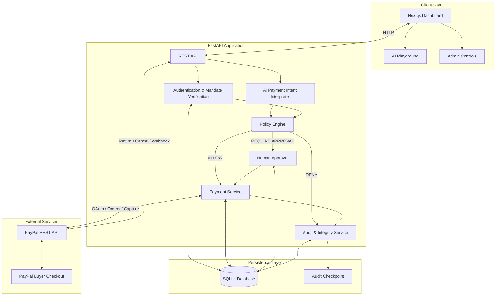
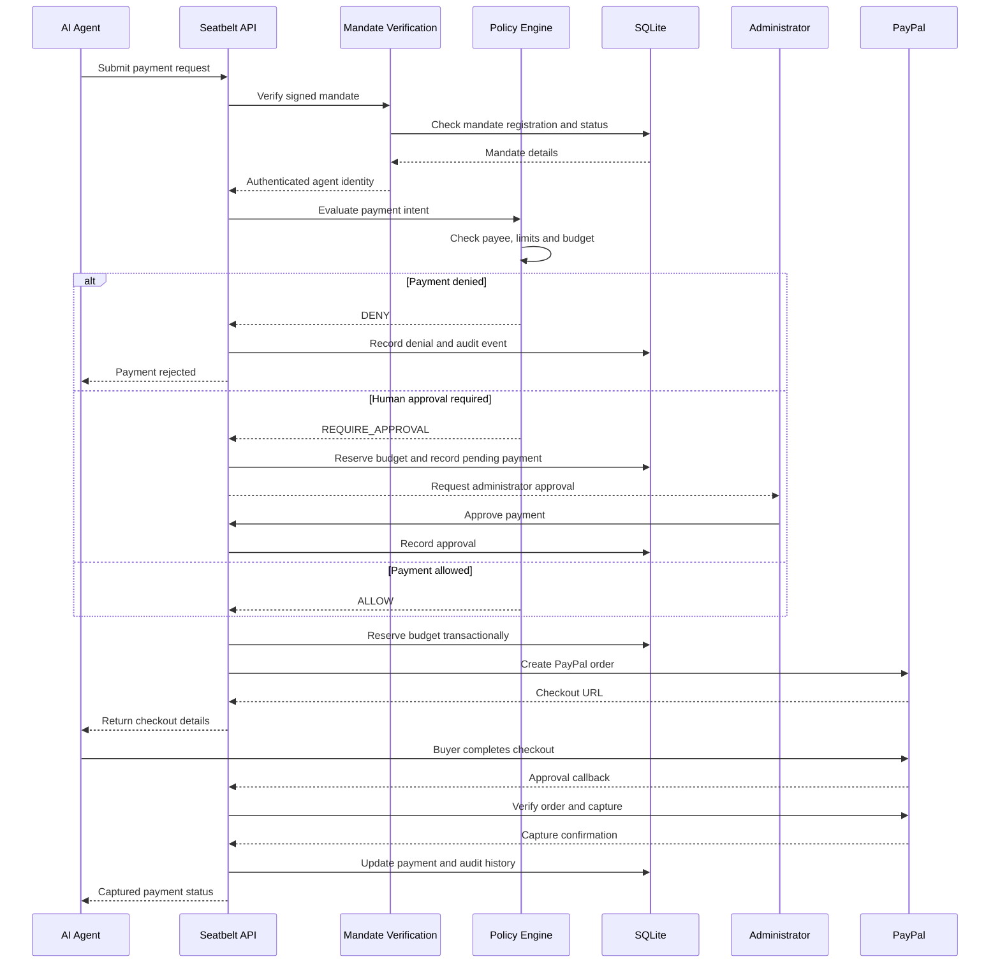

# Seatbelt

**A security and policy enforcement layer between AI agents and PayPal payments.**

Seatbelt gives AI agents a controlled way to initiate payments without giving them unrestricted access to money. Every payment is evaluated against a cryptographically signed spending mandate before it can proceed.


## The problem

AI agents can interpret instructions, select products, and initiate transactions. But an agent with direct payment access can also exceed budgets, pay unauthorized merchants, or execute unintended transactions.

Seatbelt introduces an enforceable security boundary between the agent and the payment provider.

## How it works

1. **Issue a spending mandate** — An administrator defines the agent identity, allowed payees, per-payment limit, total budget, approval threshold, and expiry.
2. **Authenticate the agent** — The agent presents its signed mandate token. Its identity is derived from the token, not trusted from the request body.
3. **Evaluate the payment** — The policy engine checks the payee, amount, currency, mandate validity, spending budget, and approval requirements.
4. **Reserve the budget** — Approved payment requests reserve funds transactionally to prevent concurrent requests from overspending.
5. **Require human approval when necessary** — Payments above the configured threshold or requiring additional authorization cannot proceed without approval.
6. **Execute through PayPal** — Eligible payments use the PayPal Checkout sandbox lifecycle.
7. **Record an audit trail** — Security-relevant events are recorded in a tamper-evident audit chain.

**AI interprets instructions; deterministic policy enforcement decides whether money can move.**

## Key features

- Cryptographically signed, time-limited spending mandates.
- Agent identity bound to the authenticated mandate.
- Per-payment and lifetime spending limits.
- Explicit allowed-payee enforcement.
- Human approval for higher-risk payments.
- Transactional budget reservations and concurrency protection.
- Request idempotency to prevent duplicate payment execution.
- PayPal sandbox checkout, approval, capture, cancellation, and recovery handling.
- Tamper-evident audit logging with checkpoint verification.
- Fail-closed payment operations when audit integrity checks fail.
- Natural-language payment intent interpretation in the AI Playground.
- Adversarial benchmark scenarios for unauthorized transfers and budget violations.


## System Architecture

Seatbelt uses a modular backend architecture with a separate web dashboard, a deterministic policy enforcement layer, transactional persistence, and PayPal integration.

### Component Architecture



### Payment Authorization Flow



### Core Design Decisions

- **Policy independent of AI:** AI output is treated as an untrusted payment proposal. All authorization decisions are made by deterministic policy code.
- **Signed mandates:** Agents authenticate using signed, time-limited spending permissions.
- **Transactional budget reservations:** SQLite transactions prevent concurrent payment requests from exceeding the authorized budget.
- **Idempotent payment execution:** Stable request identifiers and recovery handling protect against duplicate capture attempts.
- **Fail-closed audit protection:** Payment operations are blocked when audit integrity verification fails.
- **External payment execution:** PayPal handles buyer checkout and payment capture; Seatbelt retains responsibility for authorization and payment lifecycle tracking.


### Technology

 Backend API :- Python, FastAPI
 Validation :- Pydantic
 Database :- SQLite
 Payment provider :- PayPal REST API
 Frontend :- Next.js, React, TypeScript
 Styling :- Tailwind CSS
 AI interpretation :- Local AI model integration(ollama)
 Testing :- pytest
 Deployment/demo :- Local backend and frontend, PayPal Sandbox

## Getting started

### Prerequisites

- Python 3.13+
- Node.js and npm
- A PayPal Developer account with Sandbox credentials
- Git

### 1. Clone and configure

```powershell
git clone https://github.com/Aaditya-111/seatbelt.git
cd seatbelt

python -m venv .venv
.venv\Scripts\Activate.ps1

pip install -e ".[dev]"

Copy-Item .env.example .env
```

### 2. Configure environment variables

Edit `.env` and provide your PayPal Sandbox credentials.

Generate independent secrets for the mandate signing key and admin API key:

```powershell
python -c "import secrets; print(secrets.token_urlsafe(48))"
```

Configure at least:

- `PAYPAL_CLIENT_ID`
- `PAYPAL_CLIENT_SECRET`
- `PAYPAL_ENV=sandbox`
- `ALLOW_LIVE=false`
- `MANDATE_SIGNING_KEY`
- `ADMIN_API_KEY`
- `PAYPAL_RETURN_URL`
- `PAYPAL_CANCEL_URL`

Use separate random values for the signing key and admin API key. Do not commit `.env` or expose credentials.

### 3. Start the backend

From the project root:

```powershell
$env:PYTHONPATH = (Join-Path (Get-Location) "src")

python -m uvicorn seatbelt.app:build_app --factory --app-dir src --host 127.0.0.1 --port 8080
```

Check the health endpoint:

```text
http://127.0.0.1:8080/health
```

### 4. Start the frontend

Open another terminal:

```powershell
cd frontend
npm install
npm run dev
```

Open:

```text
http://localhost:3000/dashboard
```

## PayPal Sandbox callbacks

PayPal needs a publicly reachable HTTPS callback URL to redirect the buyer after checkout.

For local demonstrations, a Cloudflare Quick Tunnel can expose the backend:

```powershell
cloudflared tunnel --url http://127.0.0.1:8080
```

Use the generated HTTPS hostname in `.env`:

```dotenv
PAYPAL_RETURN_URL=https://YOUR-TUNNEL-HOST/v1/paypal/return
PAYPAL_CANCEL_URL=https://YOUR-TUNNEL-HOST/v1/paypal/cancel
```

Restart the backend after changing the configuration. If the Quick Tunnel hostname changes, update the callback URLs before creating another checkout.

## Security model

Seatbelt is designed around the principle that an AI agent must never be the authority that decides whether its own payment is permitted.

- **Mandate authenticity:** Tokens are cryptographically signed and validated.
- **Identity integrity:** Agent identity comes from the authenticated mandate.
- **Payee restrictions:** Only explicitly authorized payees are permitted.
- **Budget enforcement:** Per-payment and total spending limits are enforced independently of the AI model.
- **Approval separation:** Human approval is required where policy demands it.
- **Concurrency safety:** Database transactions protect budget reservations against simultaneous requests.
- **Payment idempotency:** Stable request identifiers and recovery logic reduce duplicate execution risk.
- **Audit integrity:** Audit-chain verification and external checkpoints help detect history modification.
- **Fail-closed behavior:** Payment mutations are blocked when audit integrity checks fail.

## Testing

Run the backend test suite:

```powershell
python -m pytest -q
```

Run Python compilation checks:

```powershell
python -m compileall -q src tests
```

Run frontend linting and production build:

```powershell
cd frontend
npm run lint
npm run build
```

The test suite includes policy boundaries, unauthorized and lookalike payees, mandate tampering and expiry, approval flows, concurrent budget reservations, PayPal lifecycle recovery, and audit integrity checks.

## Demonstration

A typical demonstration:

1. Open the dashboard.
2. Issue a mandate for an agent with a defined budget and allowed payees.
3. Use the AI Playground to describe a purchase in natural language.
4. Show the policy verdict and payment proposal.
5. Demonstrate an allowed payment or a denied unauthorized payee.
6. Show a payment requiring human approval.
7. Complete an eligible PayPal Sandbox checkout.
8. Inspect the resulting payment status and audit history.

All payment demonstrations should use PayPal Sandbox accounts and credentials.

## Project status

Seatbelt includes a working backend, frontend dashboard, AI payment-intent interpretation, policy enforcement, PayPal Sandbox integration, audit protections, and automated tests.

**This is a hackathon project, not a production payment service.** It is configured for PayPal Sandbox by default. Do not use real funds or production credentials without a separate security review and production-hardening process.

## License

Add your chosen license before distributing the project.
